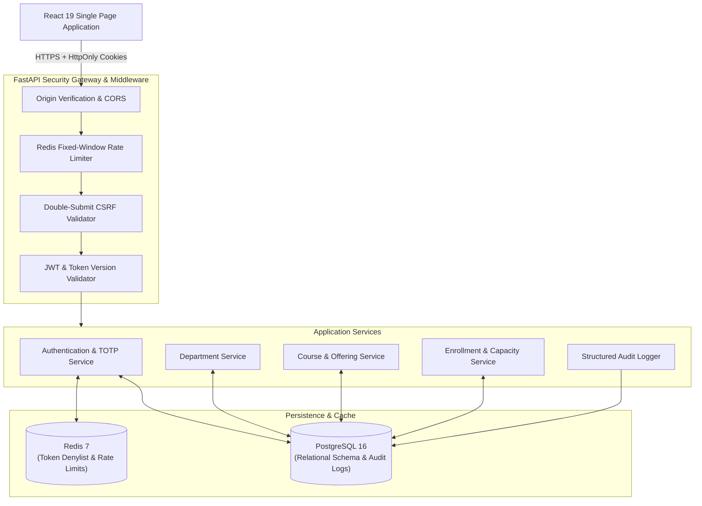
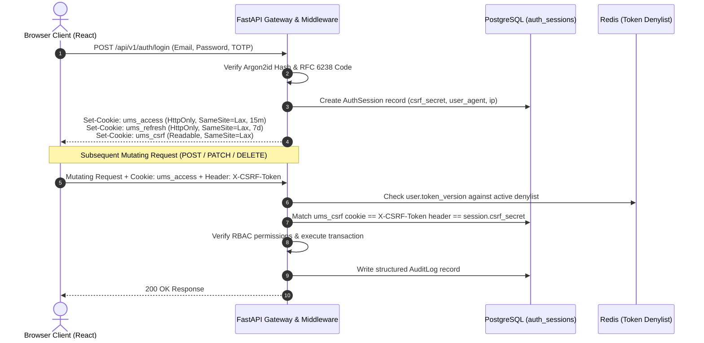
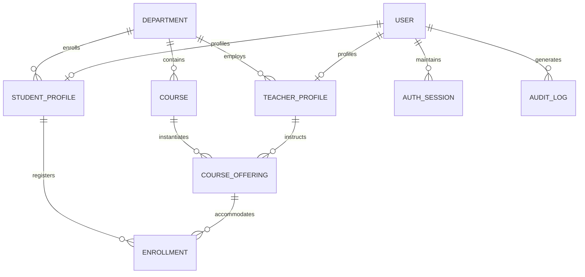

# University Management System (UMS)


A full-stack, security-first academic operations platform built with FastAPI, PostgreSQL 16, Redis 7, React 19, and TypeScript.

The system models real-world university workflows - managing academic departments, course catalogs, term-specific course offerings, section capacities, student enrollments, faculty assignments, and compliance audit logging - anchored by an enterprise zero-trust security architecture.

---

## Highlights

- **Zero-Trust Security Architecture**: All authentication tokens (`ums_access`, `ums_refresh`) are issued in `HttpOnly`, `SameSite=Lax` cookies. JavaScript storage APIs (`localStorage`, `sessionStorage`) never hold auth credentials, mitigating token exfiltration via Cross-Site Scripting (XSS).
- **Stateful Double-Submit CSRF Defense**: Mutating operations (`POST`, `PATCH`, `DELETE`) require a cryptographic CSRF token delivered via cookie and returned via the `X-CSRF-Token` header, validated against active session secrets in PostgreSQL.
- **Session Revocation & Versioning**: Immediate, cluster-wide session invalidation via `User.token_version` tracking in PostgreSQL and Redis-backed token denylists. Changing a password or logging out immediately revokes all issued tokens across all devices.
- **Refresh Token Rotation (RTR)**: Single-use refresh token exchange with automated session family invalidation if a previously consumed token is re-submitted.
- **Two-Factor Authentication (TOTP)**: In-app 2FA enrollment with real-time SVG QR code rendering, compatible with Google Authenticator, 1Password, and standard RFC 6238 authenticators.
- **Quarantine Credential State Machine**: Server-enforced temporary credential quarantine redirects users flagged with `must_change_password=True` directly to password rotation before granting access to protected application routes.
- **Course Offering Centricity**: Courses are decoupled into operational offerings defined by academic terms (`SPRING`, `SUMMER`, `FALL`), year, and section identifier, enforcing physical seat capacities and duplicate enrollment prevention.
- **Relational Integrity & Safety Guards**: Deletion constraints prevent removing departments with active faculty, students, or courses. Soft-delete and restore pipelines preserve audit continuity.
- **Multi-Tier Rate Limiting**: Redis-backed fixed-window rate limiters mitigate brute-force attempts on login endpoints, password resets, and write operations.
- **Modern Client Architecture**: React 19 single-page application with fixed-viewport navigation, command palette (`Ctrl+K` / `⌘K`), TanStack Query state caching, and responsive layouts across desktop, tablet, and mobile devices.

---

## Tech Stack

### Backend
- **FastAPI 0.115** (Python 3.11 / 3.12)
- **SQLAlchemy 2.0** (Synchronous ORM with connection pooling)
- **Pydantic v2** (Strict schema validation and settings management)
- **Alembic 1.14** (Database migration management)
- **Passlib & Argon2-cffi** (Password hashing)
- **PyOTP** (RFC 6238 TOTP two-factor authentication)
- **PyJWT** (Cryptographic JSON Web Tokens)

### Frontend
- **React 19** & **TypeScript 5**
- **Vite 4.5** (Fast bundling and code-splitting)
- **Tailwind CSS 3.4** (Custom design system tokens)
- **React Router DOM 7** (Data router with auth and quarantine guards)
- **TanStack Query v5** (Server state synchronization and caching)
- **React Hook Form 7** & **Zod 3** (Client-side validation)
- **Lucide React** (Interface iconography)

### Data & Infrastructure
- **PostgreSQL 16** (Relational data store, audit trails, and foreign key constraints)
- **Redis 7** (Fixed-window rate limiting and session blacklisting)
- **Docker Compose** (Containerized database and cache orchestration)

---

## System Architecture



---

## Security Architecture

Security is the primary engineering focus of this system. Rather than relying on simple JWT storage in client storage, the system implements defense-in-depth protection across transport, authentication, session lifecycle, and data authorization.



### 1. Zero-Storage Token Pipeline
- Access tokens (`ums_access`, 15-minute TTL) and refresh tokens (`ums_refresh`, 7-day TTL) are stored exclusively in `HttpOnly`, `SameSite=Lax` browser cookies.
- JavaScript cannot read or extract these cookies, eliminating the primary attack vector for token theft via Cross-Site Scripting (XSS).

### 2. Double-Submit CSRF Verification
- On authentication, a random CSRF secret is generated, stored in `AuthSession.csrf_secret`, and set as a readable cookie (`ums_csrf`).
- For every state-changing request (`POST`, `PUT`, `PATCH`, `DELETE`), the client must send this token in the `X-CSRF-Token` header.
- The backend verifies that the header token matches the cookie token and corresponds to the active session in PostgreSQL.

### 3. Immediate Session Revocation & Versioning
- Users maintain a `token_version` integer column.
- Whenever a user updates their password, logs out globally, or is deactivated by an administrator, their `token_version` is incremented.
- Outdated access tokens are immediately rejected by backend dependencies without waiting for the 15-minute JWT expiration.

### 4. Refresh Token Rotation (RTR) & Reuse Detection
- Refreshing an access token revokes the current refresh token and issues a new pair.
- If a previously invalidated refresh token is presented, the system detects a potential token replay attack, terminates the entire session family, and logs an alert.

### 5. Multi-Tier Rate Limiting
- Built on Redis fixed-window counters:
  - **Login IP Limit:** 20 attempts per minute.
  - **Login Account Limit:** 5 attempts per minute (prevents credential stuffing).
  - **Password Change Limit:** 5 attempts per minute.
  - **Write Operation Limit:** 120 requests per minute.

---

## Core Capabilities

### Administrative Operations (`/admin`)
- **Department Management:** Create, update, filter, and soft-delete academic departments. Protected by relational checks that prevent deleting departments that currently house faculty, students, or courses.
- **Curriculum Catalog:** Maintain standardized academic course definitions (e.g., BSCS, BSSE, BSIT) with credit hours and code format validation.
- **Course Offering Operations:** Schedule term offerings with designated section codes (`S1-A`, `S1-B`), term designations (`SPRING`, `SUMMER`, `FALL`), year, and physical seat capacity bounds.
- **Faculty Assignment & Roster Management:** Assign teachers to sections; enroll students with automatic duplicate enrollment rejection and capacity ceiling enforcement (`OFFERING_FULL`).
- **User Directory Lifecycle:** Provision teachers and students with temporary credentials, perform soft deletes, inspect archives, restore records, or execute guarded permanent deletions.
- **Compliance Audit Logging:** Structured audit trails capturing the exact actor ID, target entity, HTTP method, client IP, and human-readable event description.

### Faculty Portal (`/teacher`)
- **Dashboard Overview:** Real-time metrics displaying assigned courses and total enrolled students.
- **Assigned Offerings:** View assigned course sections and term schedules.
- **Section Rosters:** Isolated class rosters detailing enrolled students, roll numbers, academic emails, and current semesters.
- **Profile Self-Service:** View faculty record, department affiliation, and security status.

### Student Portal (`/student`)
- **Dashboard Overview:** Academic semester progress, department affiliation, and enrolled credit hours.
- **Course Schedule:** View enrolled course sections for the current academic term.
- **Offering Details:** Inspect section details, assigned instructors, and meeting metadata.
- **Profile Self-Service:** View student record and account information.

### Identity & Account Security (`/security` & `/change-password`)
- **Credential Quarantine:** Users provisioned with temporary passwords (`must_change_password=True`) are locked out of general routes and automatically redirected to `/change-password`.
- **Two-Factor Authentication (TOTP):** In-app 2FA onboarding with SVG QR code generation, manual secret backup, code verification, and session status tracking.

---

## Relational Data Model



---

## Quickstart & Local Setup

### Prerequisites
- **Docker Desktop** (Engine 24+)
- **Python 3.11+**
- **Node.js 18+** & npm

### 1. Clone & Environment Configuration
```bash
git clone https://github.com/<your-username>/university-management-system.git
cd university-management-system

# Create local environment file
cp .env.example .env
```

> **Note on Redis Port:** `docker-compose.yml` maps Redis to host port `6300` (`REDIS_URL=redis://127.0.0.1:6300/0`) to prevent port conflicts with Windows Hyper-V dynamic port exclusions.

### 2. Start PostgreSQL & Redis Containers
```bash
docker compose up -d db redis
```

### 3. Setup Python Backend
```bash
# Create and activate virtual environment
python -m venv .venv

# Windows (PowerShell):
.venv\Scripts\Activate.ps1
# Linux / macOS:
# source .venv/bin/activate

# Install dependencies in editable mode
pip install --upgrade pip
pip install -e ".[dev]"

# Run database migrations
alembic upgrade head

# Seed demo dataset and initial administrator
python -m app.scripts.seed_demo_data --reset
python -m app.scripts.seed_admin

# Start FastAPI development server
uvicorn app.main:app --host 127.0.0.1 --port 8000 --reload
```

### 4. Setup React Frontend
In a separate terminal:
```bash
cd frontend
npm install
npm run dev
```

### Local Service Ports
- **Web Application:** [http://localhost:5173](http://localhost:5173)
- **API Documentation (Swagger UI):** [http://127.0.0.1:8000/docs](http://127.0.0.1:8000/docs)
- **API Specification (ReDoc):** [http://127.0.0.1:8000/redoc](http://127.0.0.1:8000/redoc)
- **Health Check Probe:** [http://127.0.0.1:8000/health](http://127.0.0.1:8000/health)

---

## Demo Accounts

The database seed script generates pre-configured accounts for testing each role:

| Role | Email | Password | Landing Route | Description |
| :--- | :--- | :--- | :--- | :--- |
| **Administrator** | `admin@example.com` | `ChangeMe123!` | `/admin/dashboard` | Full administrative control: departments, courses, offerings, directories, and audit logs. |
| **Teacher** | `ahmed.raza.bscs@example.com` | `Welcome123!` | `/teacher/dashboard` | Assigned faculty portal: course offerings, student rosters, and profile review. |
| **Student** | `abdullah.khan.bscs@example.com` | `Welcome123!` | `/student/dashboard` | Student portal: enrolled course sections, term schedule, and academic profile. |
| **Quarantine Demo** | `areeba.raza.bscs@example.com` | `Welcome123!` | `/change-password` | Temporary credentials test: route quarantine forces immediate password change. |

---

## Verification & Testing

The repository includes a complete verification suite covering unit contracts, security posture, and static analysis:

### 1. Backend Unit & Integration Tests
```bash
pytest -q
```
Runs 23 automated test suites covering authentication, token rotation, relational constraint enforcement, offering capacity checks, soft-delete restoration, and audit logging.

### 2. Static Security & Dependency Scanning
```bash
python -m app.scripts.security_checks
```
Executes Bandit AST security scanning across `app/`, `pip-audit` for Python CVEs, `npm audit` for frontend runtime dependencies, and verifies zero `localStorage` token storage.

### 3. Frontend Typecheck & Build
```bash
cd frontend
npm run check
```
Runs ESLint, TypeScript project references (`tsc -b`), and Vite production bundling to verify zero compilation or lint errors.

---

## Project Structure

```text
university-management-system/
├── alembic/                      # Database migration revisions (0001 to 0005)
├── app/                          # FastAPI backend application
│   ├── api/                      # Route definitions and dependency injection
│   │   ├── deps.py               # Session, database, and role dependencies
│   │   └── v1/                   # Versioned API routes (admin, auth, me)
│   ├── core/                     # Application infrastructure & security configuration
│   │   ├── audit.py              # Audit logging context manager
│   │   ├── config.py             # Pydantic v2 application settings
│   │   ├── constants.py          # Enums (UserRole, AcademicTerm)
│   │   ├── cookies.py            # HttpOnly cookie helpers
│   │   ├── error_handlers.py     # Custom exception serialization handlers
│   │   ├── exceptions.py         # Domain error definitions
│   │   ├── middleware.py         # CSRF, rate limiting, and request ID middleware
│   │   ├── rate_limit.py         # Redis fixed-window rate limiter
│   │   └── security.py           # Argon2 hashing & JWT utilities
│   ├── db/                       # Engine setup and SessionLocal factory
│   ├── models/                   # SQLAlchemy ORM database models
│   ├── schemas/                  # Pydantic request and response schemas
│   ├── scripts/                  # Administrative CLI scripts (seed_demo_data, seed_admin)
│   ├── services/                 # Domain business logic services
│   └── main.py                   # Application initialization and lifespan
├── frontend/                     # React 19 + TypeScript single-page application
│   ├── src/
│   │   ├── app/                  # Application shell layout, router, and auth providers
│   │   ├── components/           # Reusable UI primitives and layout components
│   │   ├── features/             # Feature modules (admin, teacher, student, auth)
│   │   ├── lib/                  # API client, route registry, and formatters
│   │   └── styles/               # Tailwind CSS index stylesheet
│   ├── package.json              # Frontend dependencies and npm scripts
│   └── vite.config.ts            # Vite proxy and build configuration
├── tests/                        # Pytest backend test suite
├── docker-compose.yml            # PostgreSQL 16 & Redis 7 container services
├── pyproject.toml                # Python package metadata and dependencies
└── README.md                     # Project documentation
```

---

## License

This project is licensed under the [MIT License](LICENSE).
